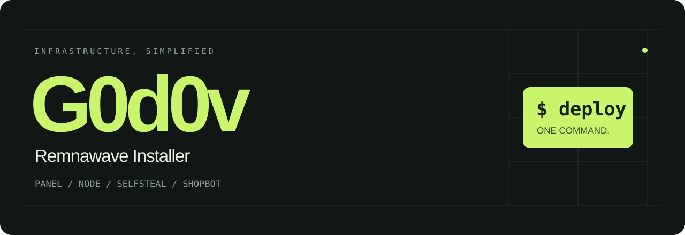
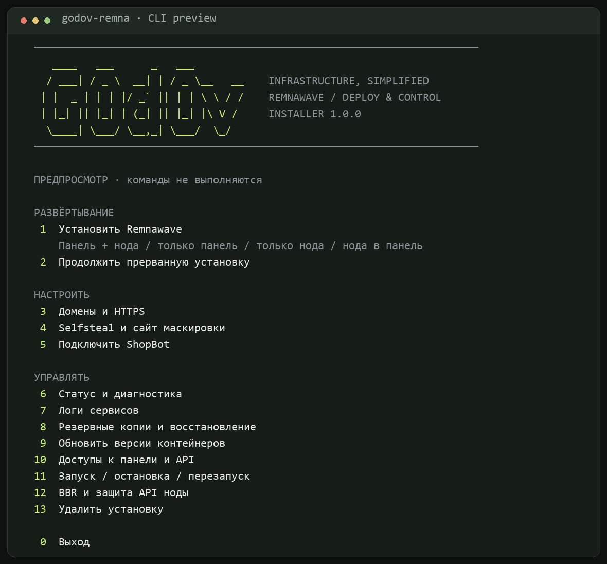
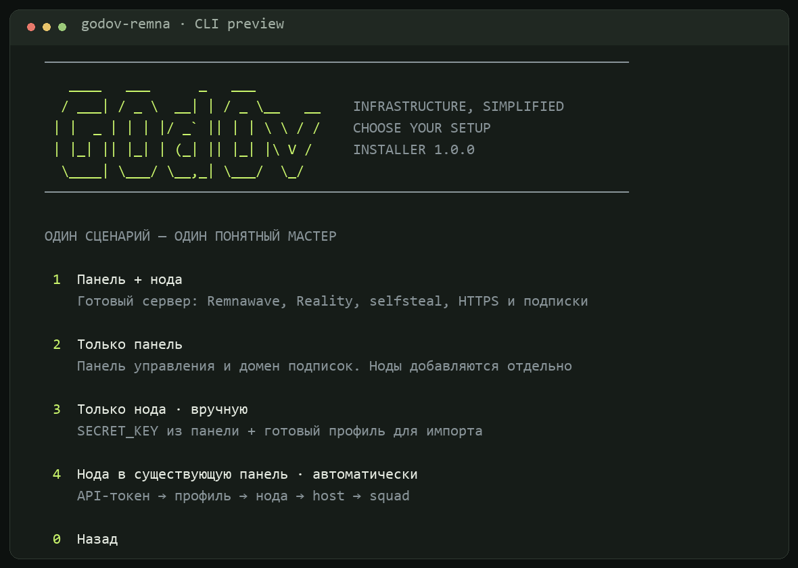
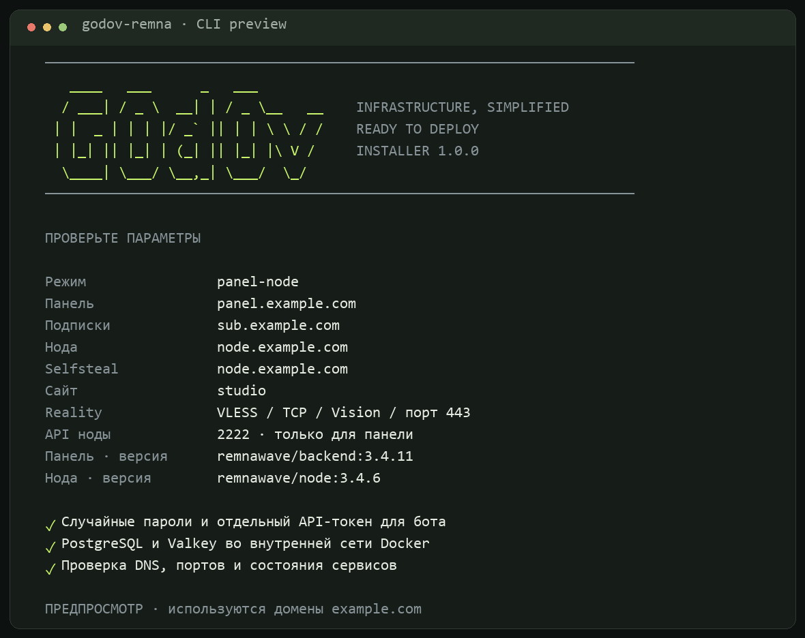

<div align="center">



**Ваш VPN-сервер. Четыре сценария установки. Одна команда.**

[](https://github.com/G0d0v/remnawave-installer/actions/workflows/ci.yml)
[](https://github.com/G0d0v/remnawave-installer/releases)
[](LICENSE)

[Установить](#установите-одной-командой) · [Сценарии](#выберите-сценарий) · [Интерфейс](#посмотрите-интерфейс) · [Команды](#управляйте-сервером) · [Документация](docs/operations.md)

</div>

## Установите одной командой

Для администратора Ubuntu/Debian: установщик разворачивает Remnawave, настраивает Reality и HTTPS, а затем подключает существующий [G0d0v ShopBot](https://github.com/G0d0v/remnawave-shopbot). Собственный бот, Telegram-токен и платёжные системы настраиваются в ShopBot.

Перед запуском подготовьте Linux-сервер с systemd, свободные порты 80/443 и DNS-записи выбранных доменов; см. [требования](#подготовьте-сервер-и-dns). Подключитесь под `root`. Если используете обычного пользователя, сначала выполните `sudo -i`. Запустите:

```bash
bash <(curl -fsSL https://raw.githubusercontent.com/G0d0v/remnawave-installer/v1.0.0/install.sh)
```

Выберите сценарий, укажите домены и подтвердите параметры. После установки открывайте управление командой:

```bash
godov-remna
```

Bootstrap загружает архив конкретного релиза и проверяет SHA-256 перед распаковкой. Контрольная сумма проверяет целостность загрузки; она не заменяет доверие к аккаунту издателя. Python-библиотеки через pip не устанавливаются.

## Выберите сценарий

Доступны четыре варианта:

| Сценарий | Результат | Что подготовить |
|---|---|---|
| **Панель + нода** | Панель, PostgreSQL, Valkey, Caddy, VLESS Reality Vision, selfsteal, host и squad | Три домена и email |
| **Только панель** | Панель управления, HTTPS и отдельный домен подписок | Два домена и email |
| **Только нода** | Агент ноды и профиль Reality для ручного импорта в панель | `SECRET_KEY` из панели, IP панели, адрес ноды |
| **Нода в панель** | Автоматическая регистрация профиля, ноды, host и внутреннего squad | URL/API-токен панели, исходящий IP панели, адрес ноды |

Совместная установка удобна для небольшого сервиса. Для разделения нагрузки выберите отдельные серверы панели и нод. Режим существующей панели рассчитан на API Remnawave 3.4.x.

## Подготовьте сервер и DNS

Установщик поддерживает следующие системы и архитектуры:

| Параметр | Панель / панель + нода | Отдельная нода |
|---|---|---|
| ОС | Ubuntu 22.04, 24.04, 26.04, 26.10; Debian 12, 13 | Те же |
| Архитектура | amd64 / arm64 | amd64 / arm64 |
| RAM | От 2 ГБ, рекомендуется 4 ГБ | От 1 ГБ |
| Диск | Рекомендуется 20 ГБ; проверяется минимум 8 ГБ свободного места | Проверяется минимум 2 ГБ свободного места |
| Доступ | Root, systemd, исходящий HTTPS к GitHub, Docker Registry и ACME | Те же |

Создайте DNS-записи с адресом выбранного сервера:

| Домен | Назначение |
|---|---|
| `panel.example.com` | Панель и защищённый API |
| `sub.example.com` | Подписки `/api/sub/SHORT_UUID`; административный API закрыт |
| `node.example.com` | Сайт маскировки и SNI Reality |

Используйте разные имена доменов. Отключите CDN proxy. Если у домена есть AAAA, IPv6 должен вести на этот же сервер. Откройте **80/tcp** и **443/tcp** в firewall сервера и у провайдера. API ноды по умолчанию использует **2222/tcp**, доступ к нему установщик ограничивает IP панели и локальной Docker-сетью.

Занятые nginx/Caddy/другим VPN порты автоматически не освобождаются. Для установки за NAT см. [проверку DNS](docs/operations.md#установка-за-nat).

## Посмотрите интерфейс

Снимки показывают фактический вывод CLI в режиме предпросмотра. Домены `example.com` — примеры; команды в этом режиме не выполняются.



<details>
<summary><b>Четыре сценария и параметры перед установкой</b></summary>





</details>

## Подключите ShopBot

При совместной установке мастер предлагает подключить работающий контейнер `remnawave-shopbot`. Для отдельного запуска привязки выполните на сервере бота:

```bash
godov-remna bind-bot --container remnawave-shopbot
```

Команда добавляет хост с URL панели, API-токеном и UUID внутреннего squad. Перед записью создаётся согласованная SQLite-копия в каталоге `backups` рядом с базой бота. Существующие пользователи, оплаты, тарифы, хосты и глобальные настройки сохраняются. Для другой схемы размещения см. [подключение удалённого бота](docs/operations.md#подключите-бота-на-другом-сервере).

После режима «только панель» сначала зарегистрируйте ноду и рабочий внутренний squad. Затем откройте `bind-bot`: мастер запросит squad и токен для бота. В ShopBot создайте тариф для добавленного хоста и проверьте выдачу тестовой подписки.

## Настройте selfsteal

В этом режиме Reality использует ваш собственный TLS-сайт как target. Xray принимает **443/tcp**, а обычный HTTPS передаёт Caddy на **127.0.0.1:8443**. Caddy обслуживает панель, подписки и сайт маскировки, выпускает и продлевает сертификаты через HTTP challenge на порту 80.

В меню **Selfsteal** доступны домен и три темы сайта: `studio`, `minimal`, `status`. Изменение доменов включает резервное копирование. Для одиночной ноды можно выбрать внешний Reality target вместо selfsteal. Произвольные внешние сайты автоматически не проверяются на совместимость с Reality.

## Управляйте сервером

Основные команды:

| Команда | Действие |
|---|---|
| `godov-remna` | Открыть меню |
| `godov-remna status` | Посмотреть контейнеры |
| `godov-remna doctor` | Проверить TLS, связь с нодой и свободное место |
| `godov-remna logs node -f` | Следить за логами ноды |
| `godov-remna domains` | Изменить домены |
| `godov-remna selfsteal` | Изменить маскировку |
| `godov-remna bind-bot` | Подключить бота |
| `godov-remna backup` | Сохранить PostgreSQL, конфиги и TLS |
| `godov-remna backup-schedule` | Включить ежедневные копии, хранить семь |
| `godov-remna update --panel-version 3.4.11 --node-version 3.4.6` | Применить конкретные версии с копией и откатом |
| `godov-remna resume` | Продолжить прерванную установку |
| `godov-remna start` / `stop` / `restart` | Управлять сервисами |
| `godov-remna bbr` | Включить BBR, если ядро поддерживает |
| `godov-remna firewall` | Повторно применить ограничение API ноды |
| `godov-remna credentials --show-secrets` | Показать доступы |
| `godov-remna tokens` | Перевыпустить токены локальной панели и бота |
| `godov-remna uninstall` | Удалить контейнеры, сохранив volumes и резервную копию |

Восстановление заменяет состояние текущей установки. Укажите путь к своей копии:

```bash
godov-remna restore BACKUP_PATH
```

Замените `BACKUP_PATH` на полный путь к архиву. Удаление данных требует отдельного флага `uninstall --purge`; перед удалением создаётся копия.

## Как хранится установка

Расположение данных:

```text
/opt/godov-remnawave/              # состояние сервера, доступ только root
├── state.json                    # параметры и секреты
├── compose.yaml                  # JSON-совместимый YAML для Docker Compose
├── panel.env / node.env
├── Caddyfile
├── credentials.txt
├── xray-profile.json             # импортируется вручную в режиме «только нода»
├── site/index.html
└── backups/

/opt/godov-remnawave-cli/          # код проверенного релиза CLI
/usr/local/bin/godov-remna        # команда управления
```

PostgreSQL, Valkey socket и данные Caddy находятся в Docker volumes проекта `g0d0v-remna`. Архивы содержат пароли и токены: храните внешнюю копию в защищённом хранилище. Для новой панели создаются отдельные токены управления и ShopBot сроком **365 дней**; перевыпускайте их в панели до истечения.

## Проверки и версии

Начальные версии зафиксированы: Remnawave **3.4.11**, Node **3.4.6**, Caddy **2.11.9**, PostgreSQL **18.4**, Valkey **9.0.0-alpine**. Установщик использует образы разработчиков; собственного форка Remnawave нет.

CI запускает ShellCheck, Bats и Python-тесты. В отдельном Ubuntu 24.04 runner проверяются настоящие контейнеры: регистрация панели, связь с нодой, HTTPS selfsteal, изоляция домена подписок, VLESS Reality Vision, повторная установка и PostgreSQL backup/restore. В CI сертификат выпускает внутренняя CA Caddy. Публичный ACME, все поддержанные ОС и ARM64 не покрываются этим прогоном.

Для локальной проверки логики выполните:

```bash
python3 -m unittest discover -s tests -v
bash -n install.sh
```

Проект распространяется по MIT. Remnawave и остальные компоненты сохраняют свои лицензии. Источники и решения: [архитектура](docs/architecture.md), [эксплуатация](docs/operations.md), [изменения](CHANGELOG.md).
